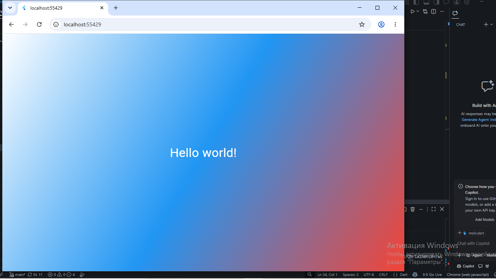

# Мое первое Flutter-приложение

Проект создан в рамках лабораторной работы №3 по изучению фреймворка Flutter. Приложение демонстрирует базовую работу с виджетами, деревом виджетов и создание красивого градиентного фона.

## Информация об авторе

- **Имя:** Коновалова Ангелина
- **Группа:** ИСП242

## Стек и версии

- **Flutter:** 3.x.x (stable)
- **Dart:** 3.x.x
- **Платформа:** Web (Chrome)
- **IDE:** VS Code

## Скриншот приложения

## Запуск

1. Клонировать репозиторий: `git clone https://github.com/sdcfghj54546/Flutter_Lab3.git`
2. Перейти в папку проекта: `cd Flutter_Lab3`
3. Выполнить `flutter pub get`
4. Запустить командой `flutter run -d chrome`

## Что изучили

- Основы работы с фреймворком Flutter и структуру проекта.
- Понятие виджетов и дерева виджетов (Widget Tree).
- Базовые виджеты: `MaterialApp`, `Scaffold`, `Center`, `Text`, `Container`.
- Создание градиента с помощью `BoxDecoration` и `LinearGradient`.
- Разницу между Hot Reload (обновление UI) и Hot Restart (полный перезапуск).
- Работу с инструментами разработчика (Flutter DevTools и Flutter Inspector).
